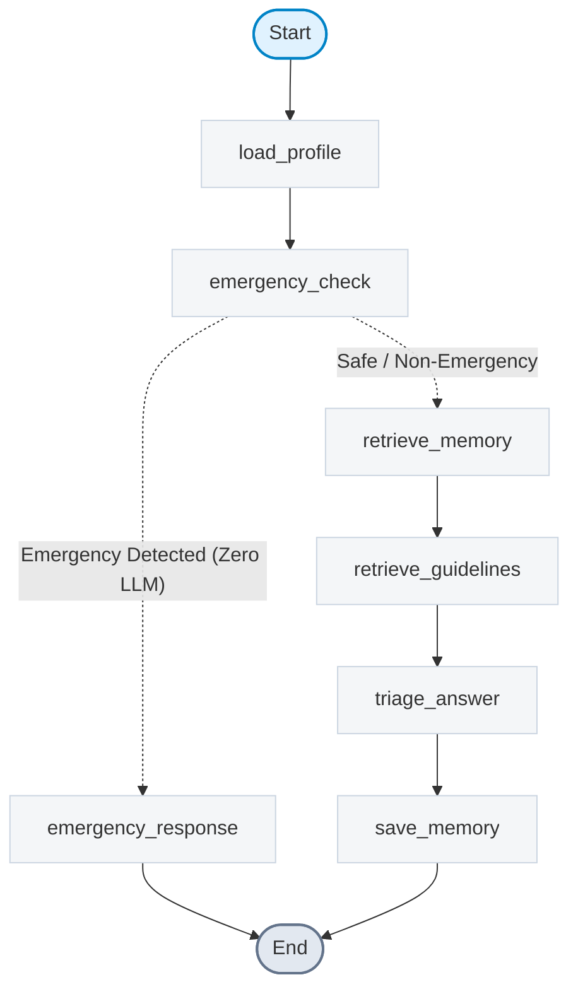

# HealthMate Compass 🧭

[](https://www.python.org/)
[](https://fastapi.tiangolo.com/)
[](https://langchain-ai.github.io/langgraph/)
[-4285F4.svg)](https://ai.google.dev/gemma)
[](https://supabase.com/)
[](https://react.dev/)
[](https://agentskills.io)
[](backend/tests/)

> **AI Diagnostic Lab & Prescription Explainer, Doctor Symptom Triage with LangGraph, Real Nearby Specialist Routing, and Permanent Cross-Chat Health Memory.**

HealthMate Compass bridges the critical gap between complex medical documents and patient comprehension. Built with **Gemma 4**, **LangGraph**, and **Supabase pgvector**, it provides high-accuracy diagnostic report translation, prescription schedule extraction with allergy conflict detection, safe symptom triage, verified clinic discovery, and permanent cross-session memory without LLM hallucinations.

---

## 🌟 Key Features

### 1. 🧪 Diagnostic Lab Report Analysis & Translation
- **Multimodal OCR Extraction:** Parses medical report photos or multi-page PDFs using high-resolution preprocessing (1280px) and Gemma 4 vision.
- **Deterministic Python Flagging Engine:** Medical values are compared against verified clinical reference ranges (`reference_ranges.json`) in pure Python code. **The LLM never determines normal, high, or low flags.**
- **Bilingual Plain Explanations:** Generates empathetic, non-diagnostic explanations at an 8th-grade reading level in English and natural Nastaliq Urdu (RTL).
- **Interactive Doctor Questions Checklist:** Equips patients with specific, actionable questions to ask their primary physician.
- **Specialist Routing:** Automatically determines the correct medical specialist (e.g., Nephrologist, Cardiologist, Endocrinologist) based on flagged abnormal values.

### 2. 💊 Doctor's Prescription Analyzer
- **Dual-Section Interface:** Dedicated tab for prescriptions to avoid conflating diagnostic reports with medication orders.
- **Structured Medication Extraction:** Identifies drug name, dosage, frequency, course duration, and administration instructions.
- **Deterministic Drug-Allergy Cross-Check:** Automatically compares prescribed medicines against the patient's verified allergies (e.g., flagging Amoxicillin/Augmentin if a Penicillin allergy is recorded).
- **1-Click Sync to Health Memory:** One click commits active medications directly to permanent patient memory facts, keeping future AI doctor chats updated.

### 3. 🩺 AI Doctor Symptom Chat (LangGraph)
- **Stateful 7-Node Agent Flow:** Governed by a compiled LangGraph `StateGraph` that manages profile loading, rule-based safety, vector memory retrieval, clinical triage, and memory persistence.
- **Zero-LLM Emergency Interceptor:** Scans user inputs using deterministic regex patterns across English, Urdu script, and Roman Urdu. Severe symptoms (chest pain, stroke signs, difficulty breathing) bypass LLM generation entirely to display immediate **Rescue 1122** calling cards and ER instructions in <50ms.
- **Context-Aware Clinical Triage:** Evaluates symptoms alongside past medical history, active medications, and chronic conditions.
- **Memory Inspector Drawer:** Slide-over debugging drawer displaying real-time profile state, injected memory facts, vector similarity scores, and raw prompt context.

### 4. 🧠 Permanent Cross-Chat Health Memory
- **Persistent Vector & Fact Storage:** Stores consultation summaries and clinical directives across sessions in Supabase using 768-dimensional Gemini embeddings (`gemini-embedding-001`) with pgvector cosine similarity matching (`match_memories` RPC).
- **Auto-Updating Medical Record:** First-person patient disclosures ("I have been diagnosed with Hypertension" or "I recovered from the flu") trigger structured profile updates with full undo capabilities.
- **Third-Person & Hallucination Defense:** Guardrails prevent profile contamination when patients discuss friends or family members.

### 5. 📍 Real Nearby Specialist Finder
- **Zero Hallucination Guarantee:** Doctor and hospital information is retrieved exclusively via Google Places API (New) with an automated fallback to OpenStreetMap / Nominatim.
- **Distance & Routing:** Calculates accurate distances using the Haversine formula and provides direct Google Maps navigation links.
- **18 Medical Specialties:** Filter by clinical specialty mapped directly from abnormal report findings.
- **24-Hour Server Cache:** Caches location results in the `doctor_cache` database table to minimize external API latency and quota consumption.

### 6. 🤖 Standardized Agent Skill (`agentskills.io` v1.0)
- Located at [`skills/safe-lab-report-explainer`](skills/safe-lab-report-explainer/SKILL.md).
- Implements the [Agent Skills open standard](https://agentskills.io) with valid YAML frontmatter, standalone reference datasets (`reference-ranges.json`, `specialty-map.json`), safety directives, and an executable flagging script (`scripts/flag_values.py`).

---

## 🏗️ Architecture & Agent Flow

### LangGraph State Machine
The chat conversation lifecycle is managed through 7 compiled nodes:


*(Mermaid specification exported directly from compiled graph: [`docs/graph.mmd`](docs/graph.mmd))*

### Technology Stack

| Layer | Technology | Purpose |
|---|---|---|
| **Backend Framework** | Python 3.11, FastAPI, Uvicorn | High-performance asynchronous REST API |
| **Agent Orchestration** | LangGraph 1.2.16, LangChain-Core 0.3.27 | Directed cyclic/acyclic stateful conversation flow |
| **Primary LLM** | Gemma 4 via Gemini API (OpenAI-compatible) | Medical reasoning, vision extraction, and triage |
| **Fallback LLM** | Gemma 4 via OpenRouter (`google/gemma-4-26b-a4b-it`) | High-availability automatic failover |
| **Structured Output** | Instructor + Pydantic v2 | Strict JSON schema validation for all LLM calls |
| **Embeddings & Vector** | Gemini Embedding API (768d, `gemini-embedding-001`) | Semantic memory representation |
| **Database & Auth** | Supabase (PostgreSQL, pgvector, RLS, Storage) | Secure user data, chat sessions, and vector store |
| **Geospatial & Places** | Google Places API (New) + OpenStreetMap Nominatim | Verified clinic and specialist discovery |
| **Frontend Framework** | React 18, TypeScript, Vite | Fast, responsive modern web interface |
| **Styling & Design** | Tailwind CSS v3, Material Symbols Outlined | Google Stitch "Clinical Calm" aesthetic system |
| **Internationalization** | i18next (English & Nastaliq Urdu RTL) | Single-language active mode with RTL layout |

---

## 🛡️ Clinical Safety Guardrails (The 5 Golden Rules)

1. **No Diagnosis:** Wording strictly adheres to observational terminology ("values may relate to"), never definitive diagnostic declarations ("you have").
2. **Deterministic Code Flags:** High/Low/Normal flags are computed strictly in Python against published medical reference intervals. The model never decides flags.
3. **Verified Doctors Only:** Clinic names, addresses, ratings, and phone numbers are queried live from Places/OSM data. The LLM never hallucinates medical providers.
4. **Rule-Based Emergency Short-Circuit:** Emergency keywords and extreme vital thresholds trigger instant emergency care instructions (Rescue 1122) with zero LLM latency or dependency.
5. **No Dosing Modifications:** The assistant provides medication schedule reminders and explanations but strictly refuses to prescribe or alter dosages.

---

## 🚀 Quick Start (Local Development)

### Prerequisites
- **Python 3.11+**
- **Node.js 18+** & **npm**
- A **Supabase** project (Postgres with `pgvector` enabled)
- Google Gemini API Key and/or OpenRouter API Key

---

### 1. Backend Setup

```bash
# Navigate to backend directory
cd backend

# Create and activate virtual environment (optional if using global Python)
python -m venv .venv
# Windows:
.venv\Scripts\activate
# Linux/macOS:
# source .venv/bin/activate

# Install dependencies
pip install -r requirements.txt

# Configure environment variables (from project root)
cp ../.env.example ../.env

# Launch FastAPI development server
python -m uvicorn app.main:app --host 127.0.0.1 --port 8000 --reload
```
*Backend runs on:* `http://127.0.0.1:8000`  
*Interactive Swagger API Docs:* `http://127.0.0.1:8000/docs`

---

### 2. Frontend Setup

```bash
# Navigate to frontend directory
cd frontend

# Install Node dependencies
npm install

# Start Vite development server
npm run dev
```
*Frontend runs on:* `http://localhost:5173`

---

### 3. Supabase Database Setup

1. Open your project dashboard at [supabase.com](https://supabase.com).
2. Go to **SQL Editor → New query**, copy and execute [`supabase/schema.sql`](supabase/schema.sql) (creates tables, vector extension, `match_memories` and `match_guidelines` RPC functions).
3. In a second query, copy and execute [`supabase/policies.sql`](supabase/policies.sql) (enables Row Level Security on all user-linked tables).
4. Go to **Storage → New Bucket**:
   - Bucket Name: `reports`
   - Privacy: **Private** (uncheck Public)
5. Copy your project URL, anon key, and service role key into your `.env` file.

---

### 4. Running the Automated Test Suite

```bash
# Run all 64 automated backend tests
cd backend
python -m pytest tests/ -v
```

The comprehensive test suite covers:
- `test_report_accuracy_golden.py`: 25 clinical test cases (CBC, LFT, Lipid, Renal, Thyroid, Diabetic, qualitative assays, and emergency panic values).
- `test_chat_and_memory.py`: LangGraph session handling and zero-LLM emergency bypass.
- `test_phase_c_memory.py`: Cross-chat multi-session fact recall, condition resolution, and third-person defense.
- `test_memory_e2e_reproduce.py`: Dual-provider memory persistence and vector similarity retrieval.
- `test_flags.py`: Deterministic lab test flagging and priority specialty assignment.
- `test_emergency.py`: Regex-based multilingual emergency detection.
- `test_doctors.py`: Haversine formula, location caching, and Google Places integration.
- `test_rls_isolation.py`: Supabase multi-tenant data isolation and auth policies.

---

## 📋 Environment Variables Reference

See [`.env.example`](.env.example) for the full template:

| Variable | Description |
|---|---|
| `GEMINI_API_KEY` | Google Gemini API key for Gemma 4 and embeddings |
| `OPENROUTER_API_KEY` | OpenRouter API key for high-availability Gemma 4 fallback |
| `SUPABASE_URL` | Supabase project REST endpoint URL |
| `SUPABASE_ANON_KEY` | Supabase public anonymous client key (frontend & backend) |
| `SUPABASE_SERVICE_ROLE_KEY` | Supabase backend administrative key (never exposed to client) |
| `GOOGLE_PLACES_API_KEY` | Google Places API (New) key for verified doctor searches |
| `GEMINI_GEMMA_MODEL` | Gemma model identifier (default: `gemma-4-26b-a4b-it`) |
| `GEMINI_EMBED_MODEL` | Embedding model identifier (default: `gemini-embedding-001`, 768d) |

---

## 🔍 Architectural Audit & Live Verification

For hackathon judges and technical auditors, an exhaustive read-only audit of the codebase, live Supabase database state, and RAG/LangGraph pipelines is documented in:
👉 **[`docs/AUDIT.md`](docs/AUDIT.md)**

### Key Audit Findings:
- **Personal Memory RAG:** Fully implemented with 768d pgvector embeddings and live query similarity matching (~0.81 cosine similarity on real historical queries).
- **LangGraph Verification:** 7 compiled nodes, zero-LLM emergency short-circuiting verified (0 LLM logs generated on emergency inputs).
- **LangChain Dependency:** No direct application imports of `langchain`; uses `langchain-core` strictly as required by `langgraph 1.x`.
- **Knowledge RAG Status:** `guideline_chunks` table exists with RPC matching, but contains 0 rows (uses general clinical principles fallback).

---

## 🗺️ Future Feature Roadmap & Backlog

Use this roadmap to select and build next-generation capabilities:

| Feature / Capability | Priority | Current Status / Gap | Implementation Plan |
|---|:---:|---|---|
| **Clinical Guidelines Seed (Knowledge RAG)** | **P0** | Table `guideline_chunks` exists, but has 0 rows. Chat uses general principles fallback. | Ingest WHO, CDC, and NICE open clinical guidelines into `app/data/guidelines/` and chunk into `guideline_chunks` using 768d embeddings. |
| **"Why This Answer?" Citations** | **P1** | Chat answers do not currently return source chunk references or citation chips. | Add `citations: List[SourceCitation]` to `ChatTurnResponse` containing matched memory fact IDs or guideline chunk references. |
| **Background Memory Processing** | **P1** | Rolling chat summary runs synchronously inside the LangGraph pipeline (~1.8s). | Offload `get_or_create_rolling_summary` to FastAPI `BackgroundTasks` to return chat responses in <2 seconds. |
| **Explicit Guardrail Node in Graph** | **P2** | Refusal for non-medical scope currently handled via prompt inside `node_triage_answer`. | Add dedicated `node_scope_check` and `node_refusal_response` with conditional routing before the triage node. |
| **Direct Lab PDF Generation** | **P2** | Users view report translations on screen; export is not yet available. | Add a PDF generation service (ReportLab or PyMuPDF) to download an annotated bilingual summary sheet for the patient's doctor. |
| **Multi-Profile / Family Switching** | **P2** | System enforces 1 patient profile per authenticated account. | Re-enable the family profile selector with isolated memory partitions if multi-patient management is desired. |
| **Voice Query & Audio Responses** | **P3** | Text input and vision only. | Integrate Web Speech API / Gemini Audio for speech-to-text input and natural Urdu speech output. |

---

## ⚖️ Medical Disclaimer

**HealthMate Compass is strictly an informational and educational tool.** It is **not** a medical device, diagnostic system, or substitute for professional medical advice, clinical diagnosis, or treatment. Always consult a licensed healthcare professional for medical concerns. In an emergency, immediately dial **Rescue 1122** (Pakistan) or your local emergency services.

---

## 📄 License

Developed for the **Gemma 4 Build Challenge** at Himmatkaar x HacktoberFest'26 Faisalabad. Distributed under the MIT License.
