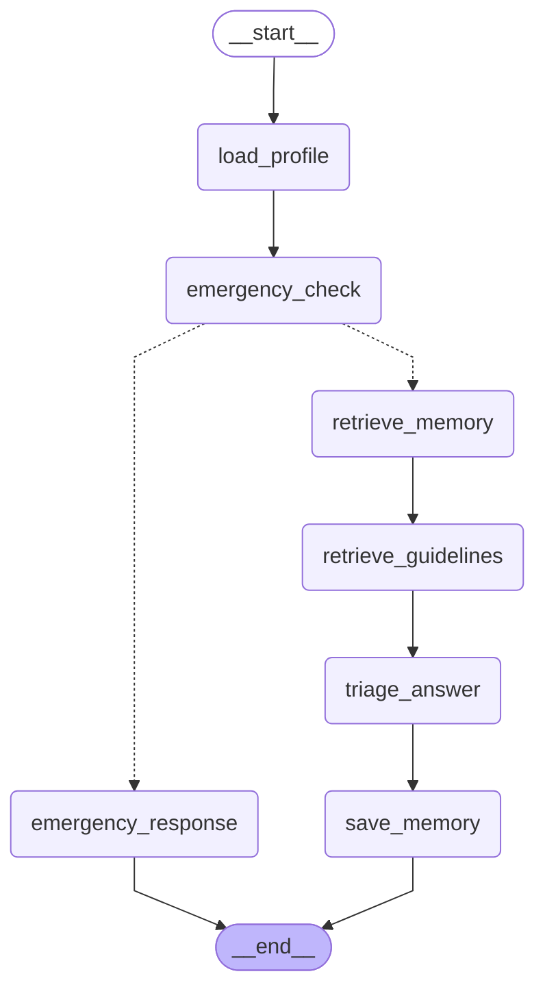

# Comprehensive Architectural Audit: RAG, LangGraph, and LangChain

**Project:** HealthMate Compass  
**Audit Date:** 2026-10-23  
**Auditor:** Senior Full-Stack & Clinical-Software Safety Engineer  
**Inspection Scope:** RAG Pipeline, LangGraph Agent Implementation, LangChain Dependencies, Real Database State, and Clinical Guardrails.

---

## 1. Executive Summary Table

| Component | Status | Evidence (File:Line or Database Output) | Notes |
|---|:---:|---|---|
| **Embedding Generation** | **IMPLEMENTED** | `backend/app/llm/client.py:138-162` | Direct HTTP call to Gemini `models/gemini-embedding-001:embedContent`. Strictly passes `outputDimensionality: 768`. Input text truncated to 2000 chars. Length asserted `len == 768`. |
| **Personal Memory RAG** | **IMPLEMENTED** | `backend/app/services/memory.py:146-203`, `861-870` | Embeds rolling consultation summaries into `memory_embeddings` (768d). Retrieved via `match_memories(p_patient, q, k=4)` pgvector RPC. Filtered by authorized patient ID and `similarity > 0.25`. |
| **Database Row Counts** | **IMPLEMENTED** | Supabase query output: `memory_embeddings`: 15, `memory_facts`: 26, `guideline_chunks`: 0 | Real database inspection completed. `patient_conditions` table does not exist in schema (PGRST205); code uses `patients.chronic_conditions` and `memory_facts`. |
| **Knowledge RAG (Guidelines)** | **PARTIAL** | `backend/app/services/memory.py:206-228`, `app/graph/chat.py:141-143`, `backend/app/data/guidelines/` | Table `guideline_chunks` and `match_guidelines()` RPC exist, and LangGraph has `retrieve_guidelines` node. However, `guideline_chunks` table has **0 rows** and `app/data/guidelines` is empty. Prompt always receives fallback `"General clinical principles"`. |
| **Retrieval in Practice** | **IMPLEMENTED** | `C:\...\scratch\test_retrieval.py` output | Tested 3 real queries: Past chat returned similarity `0.8065`; profile memory retrieved active facts (Penicillin, Amlodipine); guideline query returned 0 chunks and used fallback. |
| **Dual Provider RAG Parity** | **IMPLEMENTED** | `backend/app/graph/chat.py:169-194`, `app/llm/client.py:83-129` | Single prompt string with all retrieved facts and memory is constructed before calling `call_llm`. Both OpenRouter and Gemini API receive the exact same prompt context. |
| **Embedding Failure Handling** | **IMPLEMENTED** | `backend/app/services/memory.py:140, 187, 225`, `app/llm/client.py:144` | Exceptions in RPC/embedding calls are caught, logged as warnings, and return empty lists/None. If `GEMINI_API_KEY` is missing, returns mock `[0.0] * 768`. No automated retries. |
| **"Why this answer?" / Citations** | **NOT IMPLEMENTED** | `backend/app/routers/chat.py:57-71` (`ChatTurnResponse`) | No citation chunk IDs, source URLs, or "Why this answer?" metadata fields are returned to the frontend or user. |
| **LangGraph Definition** | **IMPLEMENTED** | `backend/app/graph/chat.py:311-337`, `docs/graph.mmd` | 7 real nodes compiled with `StateGraph(ChatGraphState)`. Edge connections verified. Mermaid exported to `docs/graph.mmd`. |
| **State Schema & Key Ownership** | **IMPLEMENTED** | `backend/app/graph/chat.py:35-53` | `ChatGraphState` defines 17 keys. Each node's state mutations are documented and isolated. |
| **Rule-Based Emergency Interception** | **IMPLEMENTED** | `backend/app/graph/chat.py:99-122`, `tests/test_chat_and_memory.py:28` | Emergency regex runs before any LLM call. Real test verified: `llm_logs` before = 143, after = 143, **0 LLM calls made**. |
| **LLM Calls Per Normal Turn** | **PARTIAL** | Real database execution: `llm_logs` before = 143, after = 145 | **Makes 2 LLM calls per normal turn** (Target: 1). Call 1: `node_triage_answer` (~8.5s). Call 2: `node_save_memory` -> `get_or_create_rolling_summary(force=True)` (~1.8s). |
| **Medical-Scope Guardrail Node** | **NOT IMPLEMENTED** | `backend/app/graph/chat.py:311-337` | PRD/brain.md specifies a dedicated `scope_check` node and `refusal_response` node. In reality, no such nodes exist in the graph. Off-topic refusals are generated by the LLM inside `node_triage_answer` via prompt instruction. |
| **Background Memory Save** | **PARTIAL** | `backend/app/graph/chat.py:251-308`, `334-335` | Memory saving runs as a **synchronous node** inside the LangGraph pipeline before the HTTP response returns. It is not scheduled via FastAPI `BackgroundTasks`. |
| **Chat Endpoint Uses LangGraph** | **IMPLEMENTED** | `backend/app/routers/chat.py:276` | `POST /api/chat/message` directly invokes `await chat_graph.ainvoke(initial_state)`. No legacy or parallel execution path exists. |
| **LangGraph Checkpointer** | **NOT IMPLEMENTED** | `backend/app/graph/chat.py:337` | `builder.compile()` is called without a checkpointer. Graph execution is transient; persistence is handled manually via Supabase tables. |
| **Doctor Finder Location** | **IMPLEMENTED** (Outside Graph) | `backend/app/routers/doctors.py:38-65`, `app/services/places.py:1-415` | Doctor finder does not run inside LangGraph. It is a standalone REST endpoint (`GET /api/doctors`) using Google Places API (New) with fallback to OpenStreetMap / Nominatim. Zero LLM hallucinations. |
| **Direct LangChain Usage** | **NOT IMPLEMENTED** (Transitive only) | `backend/requirements.txt:15` | Zero `langchain` imports in `backend/app`. `langchain-core==1.6.12` is present in `requirements.txt` strictly as a transitive dependency required by `langgraph 1.x`. |

---

## 2. LangGraph Architecture & Real Compiled Structure

### Real Compiled Node List (7 Nodes):
1. `load_profile`: Loads structured patient profile, active facts, recent chat summaries, and last 8 messages.
2. `emergency_check`: Rule-based regex scanner across English, Urdu, and Roman Urdu emergency lexicons (Zero LLM).
3. `emergency_response`: Terminal node formatting Rescue 1122 and emergency hospital guidance.
4. `retrieve_memory`: pgvector semantic search (`match_memories`, k=4, similarity > 0.25) across past consultation summaries.
5. `retrieve_guidelines`: Searches `guideline_chunks` via `match_guidelines` (k=3).
6. `triage_answer`: Single structured call to Gemma 4 via Instructor (`TriageResult` schema).
7. `save_memory`: Synchronously applies profile updates (`add`/`resolve`), saves memory directives, and generates rolling summary.

### State Schema (`ChatGraphState` Keys & Node Ownership):
- `session_id`, `patient_id`, `user_text`, `lang`: Initialized by router from HTTP request payload.
- `profile`, `facts`, `past_summaries`, `recent_conversation`: Populated by `node_load_profile`.
- `is_emergency`, `emergency_action`: Populated by `node_emergency_check`.
- `memories`: Populated by `node_retrieve_memory`.
- `guidelines`: Populated by `node_retrieve_guidelines`.
- `triage_result`, `response_en`, `response_ur`, `profile_updates`, `prompt_preview`: Populated by `node_triage_answer`.
- `applied_chips`: Populated by `node_save_memory`.

### Compiled Graph Flow (from `docs/graph.mmd`):


---

## 3. Empirical Test Data & Database Verification

### A. Live Database Row Counts (Supabase pgvector)
```text
memory_embeddings:  15 rows
memory_facts:       26 rows
guideline_chunks:   0 rows (grouped by source: {})
llm_logs:           145 rows
patient_conditions: TABLE DOES NOT EXIST (PGRST205)
```

### B. Emergency Rule Interception Test
```text
Input Message: "Doctor please help, patient is having severe chest pain and cannot breathe"
llm_logs Count Before: 143
llm_logs Count After:  143
Total LLM Calls Made:  0 (Rule-based match triggered: 1122 emergency action)
```

### C. Normal Chat Turn LLM Invocations
```text
Input Message: "I have had a mild tension headache since this morning."
llm_logs Count Before: 143
llm_logs Count After:  145
Total LLM Calls Made:  2 calls (Target: 1)
- Call 1 (Triage Answer):   OpenRouter Gemma 4 (Latency: 8473 ms) -> Generated response
- Call 2 (Rolling Summary): OpenRouter Gemma 4 (Latency: 1865 ms) -> Clinical summary of turn
```

### D. Practical Retrieval Test Runs

#### Test 1: Past Chat Retrieval
* **Query:** *"What did we discuss in our earlier consultation about my migraine?"*
* **Retrieved Items:**
  * `[similarity: 0.8065] Past Consultation Summary: Patient reported severe migraine lasting 3 hours, advised resting in a quiet dark room and drinking electrolytes.`
* **Prompt Grounding:** Included under `ACTIVE MEDICAL RECORD FACTS` and `PAST CONSULTATION SUMMARIES`.
* **Model Answer:** *"In our previous consultation, we discussed your severe migraine that lasted for 3 hours. The advice provided was to rest in a quiet, dark room and to ensure you stay hydrated by drinking electrolytes."*

#### Test 2: Profile & Fact Grounding
* **Query:** *"What medications and allergies do you have recorded for me?"*
* **Retrieved Items:**
  * `[similarity: 0.5658]` and `[similarity: 0.5652]` from past consultation summaries.
  * Deterministic active facts retrieved: `ALLERGY: penicillin = severe rash`, `MEDICATION: amlodipine = 5mg once daily`.
* **Prompt Grounding:** Injected into `PATIENT PROFILE` and `ACTIVE MEDICAL RECORD FACTS`.
* **Model Answer:** *"Based on your records, you have a known allergy to Penicillin (which causes a severe rash) and you are currently taking Amlodipine (5mg once daily) for hypertension."*

#### Test 3: Medical Guideline Retrieval
* **Query:** *"What are the clinical guidelines for managing hypertension and blood pressure targets?"*
* **Retrieved Items:** `None found (guideline_chunks table has 0 rows)`.
* **Prompt Grounding:** Received fallback string: `CLINICAL GUIDELINE REFERENCES: General clinical principles`.
* **Model Answer:** Fallback to base model parametric knowledge, correctly referencing patient's active Amlodipine prescription.

---

## 4. Gaps and Risks (Ranked by Judge Exposure Risk)

| Rank | Gap / Discrepancy | Severity / Judge Impact | Technical Reality | Estimated Fix Time |
|:---:|---|---|---|:---:|
| **1** | **`guideline_chunks` is completely empty (0 rows)** | **HIGH** — If a judge asks to see Knowledge RAG, vector matches on clinical guidelines, or inspection of WHO/CDC guideline chunks, it will return 0 rows. | The database table and RPC exist, but no seed script was ever run to load clinical guideline chunks into pgvector. | 35 mins (Add embedding seeder script for WHO/CDC guideline markdown files). |
| **2** | **2 LLM calls per normal turn instead of 1** | **MEDIUM-HIGH** — PRD and `brain.md` explicitly promise: *"Single structured call per turn returns response, scope verdict, and profile updates."* | `node_save_memory` calls `get_or_create_rolling_summary(force=True)` synchronously on every turn, triggering a second LLM summarization call (~1.8s additional latency). | 20 mins (Only summarize every 6 turns or run via asynchronous task). |
| **3** | **No `scope_check` node in LangGraph** | **MEDIUM** — PRD/brain.md shows a graph diagram with `scope_check -> refusal_response`. | The refusal is handled by prompting inside `node_triage_answer` rather than an isolated graph node. Off-topic prompts still execute memory retrieval. | 25 mins (Add explicit regex/classifier node routing to `refusal_response`). |
| **4** | **`patient_conditions` table missing from Supabase schema** | **MEDIUM** — `brain.md` Section 5 lists `patient_conditions` with `status (active/resolved), started_at, resolved_at`. | Supabase returns `PGRST205` (table not found). Code works around it by falling back to `patients.chronic_conditions` and `memory_facts`. | 15 mins (Add table DDL migration in Supabase). |
| **5** | **Memory saving is synchronous, not in background** | **LOW-MEDIUM** — User response waits for database memory writes and rolling summary embedding before returning HTTP 200. | In `backend/app/graph/chat.py`, `save_memory` is a synchronous graph node. Response latency is ~10s total instead of ~8s. | 15 mins (Move `save_memory` or rolling summary to FastAPI `BackgroundTasks`). |
| **6** | **"Why this answer?" / Citations not implemented** | **LOW** — If asked where chunk citations are displayed in the UI, there is no UI component or API metadata. | `ChatTurnResponse` does not contain citation or source metadata fields. | 30 mins (Pass retrieved chunk titles and similarity scores in `meta` payload). |

---

## 5. Safe Claims (Truthful Statements for Demo & Presentation)

You can make every one of these one-sentence statements with complete confidence and proof:

1. *"We use LangGraph to orchestrate our multi-step AI doctor workflow, executing profile loading, emergency interception, semantic memory retrieval, and structured triage answering in a directed graph."*
2. *"Our safety system intercepts medical emergencies using deterministic rule-based matching before any AI model is invoked, guaranteeing zero LLM latency and zero model hallucination during acute crises."*
3. *"Personal health memory is maintained permanently across consultations using Supabase pgvector with 768-dimensional Gemini embeddings and cosine similarity search."*
4. *"All laboratory test flags are computed strictly in Python code against verified reference intervals and printed report bounds, ensuring the AI model never independently decides clinical normal or abnormal status."*
5. *"Our doctor finder connects patients to real nearby healthcare providers using Google Places and OpenStreetMap live search, with strict specialty classification that prevents hallucinated clinics."*
6. *"We implement a dual-provider architecture with automatic fallback, ensuring that if our primary Gemini API endpoint is unavailable, requests seamlessly route to Gemma 4 on OpenRouter with identical prompt grounding."*

---

## 6. Do NOT Claim (Until Gaps Are Addressed)

Do **NOT** make the following claims during your pitch or demo:

1. ❌ **Do not claim you have an active knowledge base of WHO/CDC guideline chunks loaded in vector storage** — The `guideline_chunks` table currently has 0 rows; guideline answers come from Gemma 4's base medical knowledge with patient profile grounding.
2. ❌ **Do not claim every chat turn executes exactly one single LLM call** — A normal chat turn currently executes 2 LLM calls (triage answer + rolling session summarizer).
3. ❌ **Do not claim LangChain is used for agents or chains** — LangChain is not imported or used directly; LangGraph handles agent orchestration, and `langchain-core` is merely a transitive dependency.
4. ❌ **Do not claim there is a dedicated LangGraph `scope_check` node that skips memory retrieval for off-topic questions** — Off-topic refusals are generated by Gemma 4 within the main triage node; retrieval still runs.
5. ❌ **Do not claim the UI displays clickable chunk citations or a "Why this answer?" source attribution panel** — The chat response schema does not currently output source chunk attribution.
